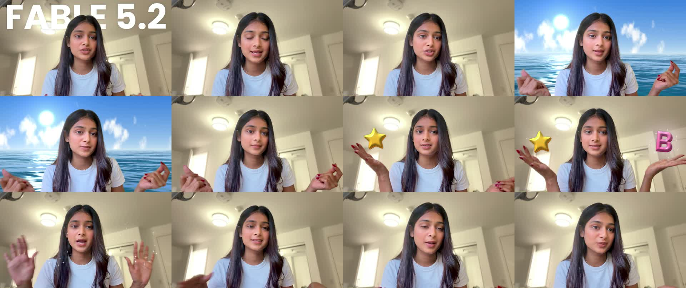

# fable-vfx

**The effects from my "Fable 5.2 just launched" video, as a Claude skill and one prompt.** You record yourself talking to your phone. Claude puts a title behind your head, turns the room into an ocean when you snap, lands a 3D star and a letter on your palms, and adds the sounds. No After Effects, no stock footage, nothing leaves your computer.



## The one prompt

Clone this repo (or use the green **Use this template** button), put your clip in `footage/`, open the folder in Claude Code, and paste:

```text
Use the fable-vfx skill in this repository on my clip.

Source: footage/[MY VIDEO].mov
Title behind my head: [YOUR TITLE]
Ocean on my snaps: yes
Props: a gold star on my left hand when I say "[...]", the letter B on my right hand when I say "[...]"
Vanish when I say: "[...]"
Speed: 1.0
```

That is it. Claude watches the clip, finds the seconds where you say each thing, checks where your hands are, shows you test frames, fixes them until they look right, renders, and hands you the file. About 15 minutes for a 30 second clip on a Mac, most of it rendering.

The skill is in `.claude/skills/fable-vfx/SKILL.md` (Claude Code) and `.agents/skills/fable-vfx/SKILL.md` (Codex). Same file. The longer prompt and a revision prompt are in [`prompts/`](prompts/).

## How to record so it works

- Phone on a stand, landscape, do not move the camera.
- Plain wall behind you if you can. Daylight on your face.
- When you snap, hold the hand up and in frame. When you "hold" a prop, palm up, a little away from your body, and keep it there for a beat.
- Say the moments out loud: "when I snap my fingers", "a star appears here", "the letter B appears here", "and now it's back". Claude uses your words to find the seconds.
- One take is fine. It trims the dead air at the start.

## What you can ask for

Without touching code: the title text and font, which snaps do what, a star or a letter or a short word on either hand, whether it flies in or pops out of the palm, its size and colour (gold, pink, sky, mint, or yours), when everything vanishes, playback speed, how loud the effects are, no grade, no ocean, no title. Ask in seconds of the finished video, like "18.4: the star is too high". [`prompts/revisions.md`](prompts/revisions.md) shows how.

Not in here: captions. The version I posted had a captions pass from a different tool. Add yours after.

## What you need

A Mac with [ffmpeg](https://formulae.brew.sh/formula/ffmpeg) (`brew install ffmpeg`), Python 3.10 or newer, and Xcode command line tools (`xcode-select --install`, for the Apple Vision matte). Then `pip install -r requirements.txt`. Claude Code or Codex with your own account; the model is not included.

Not on a Mac? Everything except the person matte runs anywhere. [`docs/pipeline.md`](docs/pipeline.md) explains what to bring.

## Want to run it yourself, no AI?

```bash
cp configs/fable-5-2.json configs/mine.json      # edit the times and the title
python3 render.py configs/mine.json all
```

[`configs/fable-5-2.json`](configs/fable-5-2.json) is the exact config that made my video. Every number that was specific to my recording is in that file and nowhere else. [`docs/config.md`](docs/config.md) explains each key, [`docs/pipeline.md`](docs/pipeline.md) each step, and [`docs/how-it-works.md`](docs/how-it-works.md) how the ocean, the props and the sounds are made from scratch.

## How this was made

I recorded one take on my iPhone and asked Claude (Fable 5.2) in Claude Code for the effects I had in my head. It wrote the person matte with Apple Vision, the ocean, the props and the sounds in one session, with me reviewing stills in between. The first version had every timing hard-coded for my clip. This repo is that code with the timings moved into a config and the steps I took written down as a skill, so you can run the same thing on yours.

## Credits

Recorded and published by [Bhavya Goel](https://github.com/bhavya-gx). Code written with Claude Fable 5.2 in Claude Code. Poppins by the Indian Type Foundry, SIL OFL. MIT licensed, see [LICENSE](LICENSE). Contributions welcome, see [CONTRIBUTING.md](CONTRIBUTING.md); `main` is pull-request only.
